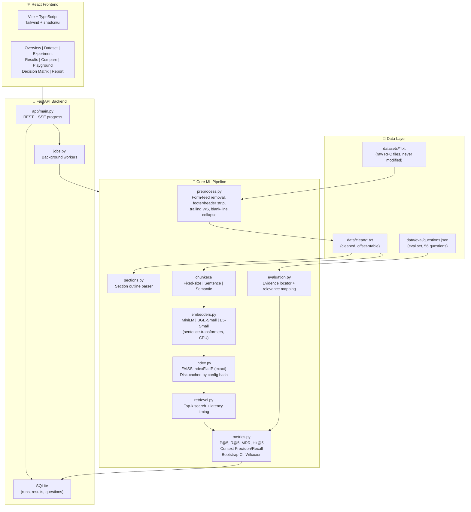

# RFC RAG Chunking Lab

A reproducible research application for **"Comparative Analysis of Chunking Strategies and Embedding Models on RAG Retrieval"** using IETF RFC plain-text documents as the corpus.

> **University mini-project** — Prompt Engineering & Optimization for Generative AI.
> Every number shown in the UI comes from a measured run. No results are invented or hardcoded.

---

## Table of Contents

1. [Architecture](#architecture)
2. [Quick Start — Windows](#quick-start--windows)
3. [Quick Start — macOS / Linux](#quick-start--macoslinux)
4. [Running Each Step](#running-each-step)
5. [How to Add Questions](#how-to-add-questions)
6. [How to Add Models](#how-to-add-models)
7. [How to Add Chunkers](#how-to-add-chunkers)
8. [Metric Definitions](#metric-definitions)
9. [Limitations](#limitations)
10. [Reproducibility](#reproducibility)
11. [Assumptions](#assumptions)

---

## Architecture



---

## Quick Start — Windows

### Prerequisites
- Python 3.11 (from python.org)
- Node.js 20+ (from nodejs.org)
- Git

### Setup

```powershell
# 1. Clone and enter the repo
git clone <repo-url>
cd RAG-chunking-embedding-analysis

# 2. Create and activate a virtual environment
python -m venv .venv
.venv\Scripts\Activate.ps1

# 3. Install Python dependencies
pip install -r requirements.txt

# 4. Download NLTK data
python -c "import nltk; nltk.download('punkt'); nltk.download('punkt_tab')"

# 5. Install frontend dependencies
cd frontend
npm install
cd ..

# 6. Copy environment template
copy .env.example .env
# Edit .env if you want LLM-based groundedness evaluation

# 7. Start both servers
.\scripts\dev.ps1
```

### Running steps individually

```powershell
# Preprocess raw RFCs → data/clean/
python preprocess.py

# Validate evaluation questions
python -m app.cli validate-questions

# Run the quick experiment preset
python -m app.cli run --preset quick

# Generate a report
python -m app.cli report
```

---

## Quick Start — macOS / Linux

### Prerequisites
- Python 3.11 (`brew install python@3.11` or `pyenv install 3.11`)
- Node.js 20+ (`brew install node` or `nvm install 20`)

### Setup

```bash
# 1. Clone and enter the repo
git clone <repo-url>
cd RAG-chunking-embedding-analysis

# 2. Create and activate a virtual environment
python3.11 -m venv .venv
source .venv/bin/activate

# 3. Install Python dependencies
pip install -r requirements.txt

# 4. Download NLTK data
python -c "import nltk; nltk.download('punkt'); nltk.download('punkt_tab')"

# 5. Install frontend dependencies
cd frontend && npm install && cd ..

# 6. Copy environment template
cp .env.example .env

# 7. Start both servers
bash scripts/dev.sh
```

---

## Running Each Step

| Step | Command | Output |
|------|---------|--------|
| Preprocess RFCs | `python preprocess.py` | `data/clean/*.txt` |
| Validate questions | `python -m app.cli validate-questions` | Console report |
| Quick run (9 configs) | `python -m app.cli run --preset quick` | `results/` |
| Full run (42 configs) | `python -m app.cli run --preset full` | `results/` |
| Verified-only run | `python -m app.cli run --preset quick --verified-only` | `results/` |
| Generate report | `python -m app.cli report` | `results/report.*` |
| Start API server | `uvicorn app.main:app --reload` (in `backend/`) | http://localhost:8000 |
| Start frontend | `npm run dev` (in `frontend/`) | http://localhost:5173 |

---

## How to Add Questions

1. Open `data/eval/questions.json`.
2. Add an entry following the schema (see `data/eval/questions.json` for examples).
3. Run `python -m app.cli validate-questions` — it will check that every `evidence[].quote` exists verbatim in the cleaned text.
4. Fix any validation errors (usually whitespace normalisation issues).
5. Set `verified: true` after human review in the UI's **Review Mode** page.

**Rules for question quality:**
- Evidence must be a *verbatim* 1-3 sentence quote from the cleaned text.
- Question wording must NOT copy phrases from the evidence (paraphrase).
- No questions answerable from the title/heading alone.

---

## How to Add Models

Edit `configs/models.yaml` and add an entry:

```yaml
- model_id: my_model
  name: "my-model-name"
  hf_path: "org/model-name"          # HuggingFace model path
  max_seq_length: 512                 # model's native token limit
  embedding_dim: 768
  query_prefix: "query: "            # "" if none
  passage_prefix: "passage: "        # "" if none
  normalize: true
  description: "Brief description."
  notes: "Any caveats."
```

Then reference `my_model` in `configs/experiment.yaml` under `models:`.

> **Note:** Models are downloaded on first use from HuggingFace Hub.
> CPU-only inference is used throughout. Add the model to `configs/experiment.yaml` to include it in runs.

---

## How to Add Chunkers

1. Create `backend/app/core/chunkers/my_chunker.py` implementing the `BaseChunker` interface:

```python
from .base import BaseChunker, Chunk

class MyChunker(BaseChunker):
    strategy = "my_strategy"

    def chunk(self, text: str, doc_id: str) -> list[Chunk]:
        ...  # return list of Chunk objects with all required fields
```

2. Register it in `backend/app/core/chunkers/__init__.py`.
3. Add a configuration entry to `configs/experiment.yaml`.
4. Write tests in `backend/tests/test_chunkers.py`.

---

## Metric Definitions

| Metric | Definition |
|--------|-----------|
| **Precision@k** | Fraction of top-k retrieved chunks that are relevant. |
| **Recall@k** | Fraction of relevant chunks (for this query) retrieved in top-k. |
| **MRR** | Mean Reciprocal Rank — mean of 1/rank for the first relevant chunk. |
| **Hit@k** | 1 if at least one relevant chunk is in top-k, else 0. |
| **Context Precision** | RAGAS-style rank-weighted precision: mean of P@j taken at each rank j where the chunk is relevant. |
| **Context Recall** | Fraction of gold evidence characters covered by the union of retrieved chunks. |
| **Answer Groundedness** | (Optional) Fraction of answer atomic claims supported by retrieved context. Uses a constant LLM judge; not a study variable. |
| **Bootstrap 95% CI** | 1000-resample bootstrap confidence interval on the mean, seed=42. |
| **Wilcoxon p-value** | Paired signed-rank test comparing per-query metric values between two configurations. |

**Relevance criterion:** A chunk is relevant to a query if it overlaps an evidence span by ≥ `min_overlap_chars` characters (default 40) OR fully contains the evidence span. This is configurable in `configs/experiment.yaml`.

---

## Limitations

1. **CPU-only**: All embedding and inference runs on CPU. Expect ~1-10 min for the `quick` preset and ~1-2 hours for `full` on a modern laptop.
2. **Small corpus**: Four RFCs (~1 MB total). Results may not generalise to larger or more diverse corpora.
3. **all-MiniLM-L6-v2 truncation**: This model has a 256 word-piece limit. Chunks with 512 tiktoken tokens will be silently truncated by the model. The UI shows a **truncation warning** with the exact truncation rate per configuration. This is a known confound and is documented, not hidden.
4. **Semantic chunker embedder is fixed**: The semantic chunker always uses `all-MiniLM-L6-v2` to detect boundaries, regardless of the embedding model under test. This keeps chunk boundaries identical across embedding-model experiments. See `configs/models.yaml` → `chunking_embedder`.
5. **Evaluation questions are LLM-drafted**: All 56 questions are marked `verified: false` and `drafted_by: llm`. Human review is required before treating results as ground truth. The UI shows a banner on any result computed with unverified questions.
6. **No distributed inference**: FAISS uses exact search (`IndexFlatIP`). ANN approximation errors do not confound latency measurements, but index build time scales with corpus × chunk count.
7. **Answer groundedness is off by default**: Enabling it requires a running Ollama instance or an API key in `.env`.

---

## Reproducibility

- **Default seed**: 42 (bootstrap resampling, semantic chunker random tie-breaking).
- **Corpus hash**: SHA-256 of all cleaned texts concatenated, stored in every run manifest.
- **Question-set hash**: SHA-256 of `data/eval/questions.json`, stored in every run manifest.
- **Config hash**: Deterministic hash of chunking config + model ID, used as the cache key for embeddings and FAISS indexes.
- **Library versions**: Pinned in `requirements.txt`. Run manifest includes Python version, OS info, and library versions at run time.
- **Cache invalidation**: Any change to cleaned text, chunking config, or model invalidates the relevant cache entry. Stale cache is never served (hash mismatch raises an error).

To re-run from scratch: `python -m app.cli run --preset quick --no-cache`.

---

## Assumptions

> Items marked with ⚠️ are design decisions made where the spec was ambiguous.

1. **Token counting uses tiktoken cl100k_base** for chunk boundaries and `chunk_tokens` parameters, regardless of the embedding model's own tokenizer. This ensures identical chunk boundaries across all models. The model's native tokenizer is used only for computing the truncation rate.
2. **Relevance is binary** (a chunk either overlaps evidence by ≥ 40 chars or it doesn't). No graded relevance is used.
3. **Recall denominator** = number of chunks in the index that overlap evidence for that query (not total evidence spans). This makes Recall@5 interpretable when evidence spans are very short.
4. **Semantic chunker** uses cosine similarity between adjacent sentence embeddings (window=1). Similarity below the configured percentile threshold triggers a new chunk boundary.
5. ⚠️ **Context Precision** uses the RAGAS rank-weighted formulation (mean of P@j at relevant ranks), not simple P@k.
6. ⚠️ **Context Recall** is character-overlap-based (union of retrieved chunk spans vs. union of gold evidence spans), not token-based.
7. ⚠️ **The semantic chunker boundary embedder** (`all-MiniLM-L6-v2`) is excluded from the embedding-model study variable to avoid confounding chunking strategy with embedding model choice.
8. ⚠️ **56 evaluation questions** (14 per RFC) drafted by LLM and validated against the cleaned text. All start as `verified: false`. Results with unverified questions show a UI banner.
9. **FAISS IndexFlatIP** (exact inner-product search) is used so that latency differences reflect the embedding model and chunk count, not ANN approximation.
10. **LLM answer generation** uses the same provider/model/prompt for all runs (held constant). It is not a study variable.
