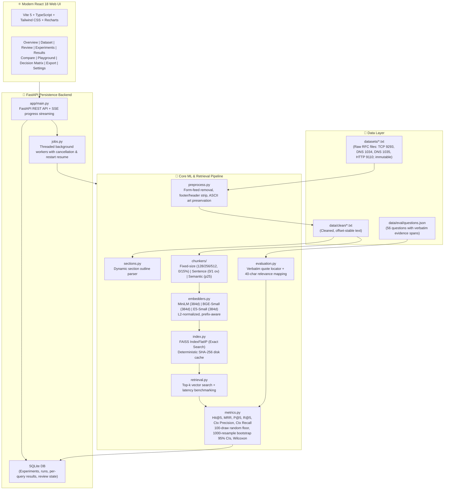

# RFC RAG Chunking Lab

A reproducible, controlled experimental research platform for **"Comparative Analysis of Chunking Strategies and Embedding Models on RAG Retrieval"** using technical networking documentation from the Internet Engineering Task Force (IETF RFCs).

> **Academic Research Project** — Prompt Engineering & Optimization for Generative AI.  
> **Core Principle:** Strictly controlled empirical evaluation. Every configuration is evaluated against identical questions, verbatim evidence spans, fixed top-$k=5$, and uniform metrics. No performance claim is assumed; every number derives from measured runs.

---

## Research Questions

- **RQ1 (Chunking Strategy Effect):** How do token-window fixed-size chunking, structure-preserving sentence-level chunking, and embedding-driven semantic chunking affect retrieval effectiveness across different window capacities ($N \in \{128, 256, 512\}$ tokens) and overlap ratios?
- **RQ2 (Model & Strategy Interaction):** How does embedding model architecture—specifically comparing symmetric sentence encoders (`all-MiniLM-L6-v2`) against instruction-tuned asymmetric models (`bge-small-en-v1.5`, `e5-small-v2`)—interact with chunking granularities and token length distributions?
- **RQ3 (Operational Trade-offs):** What empirical trade-offs exist between retrieval precision, answer groundedness, indexing latency, preprocessing overhead, and memory/index footprint when constrained to CPU execution?

---

## Architecture



---

## One-Command Reproduction

Execute the full pipeline (cleaning $\to$ question validation $\to$ quick benchmark $\to$ publication asset generation) in a single script:

### Windows 11 (PowerShell)
```powershell
.\scripts\reproduce.ps1
```

### Linux / macOS (Bash)
```bash
bash scripts/reproduce.sh
```

---

## Prerequisites & Installation

### System Requirements
- **Python:** 3.11.x (CPU-only build; PyTorch and FAISS run on CPU)
- **Node.js:** 20.x or 22.x LTS with npm
- **Disk Space:** ~500 MB for Python/Node dependencies and cached models
- **Model Downloads:** Embedding models (`all-MiniLM-L6-v2`, `bge-small-en-v1.5`, `e5-small-v2`) are downloaded automatically from Hugging Face Hub on first run (~350 MB total).

### Manual Setup

#### Windows 11 (PowerShell)
```powershell
# 1. Clone repository
git clone <repo-url>
cd RAG-chunking-embedding-analysis

# 2. Python virtual environment
python -m venv .venv
.venv\Scripts\Activate.ps1
pip install -r requirements.txt

# 3. Download NLTK tokenizer tables
python -c "import nltk; nltk.download('punkt'); nltk.download('punkt_tab')"

# 4. Frontend setup
cd frontend
npm install
cd ..

# 5. Environment configuration
copy .env.example .env
```

#### macOS / Linux (Bash)
```bash
# 1. Clone repository
git clone <repo-url>
cd RAG-chunking-embedding-analysis

# 2. Python virtual environment
python3 -m venv .venv
source .venv/bin/activate
pip install -r requirements.txt

# 3. Download NLTK tokenizer tables
python3 -c "import nltk; nltk.download('punkt'); nltk.download('punkt_tab')"

# 4. Frontend setup
cd frontend && npm install && cd ..

# 5. Environment configuration
cp .env.example .env
```

---

## CLI Workflow

The command-line interface provides reproducible commands for all pipeline stages:

| Command | Description | Primary Output |
| :--- | :--- | :--- |
| `python -m app.cli preprocess` | Cleans raw RFCs while preserving ASCII diagrams and headings | `data/clean/*.txt` |
| `python -m app.cli validate-questions` | Validates schema, verbatim quote presence, and section ranges | Console diagnostic report |
| `python -m app.cli export-review` | Exports questions to review sheet for human grading | `results/review_sheet.csv` |
| `python -m app.cli import-review <csv>` | Ingests completed review verdicts (`approve`/`reject`) | Updates `questions.json` |
| `python -m app.cli run --preset quick` | Executes controlled 9-run benchmark (3 chunkers &times; 3 models) | `results/<run_id>/` |
| `python -m app.cli run --preset full` | Executes full grid benchmark (14 chunkers &times; 3 models = 42 runs) | `results/<run_id>/` |
| `python -m app.cli run --verified-only` | Restricts evaluation strictly to human-verified questions | `results/<run_id>/` |
| `python -m app.cli report` | Prints formatted terminal leaderboard from latest run | Console summary table |
| `python -m app.cli report-assets --run latest` | Generates publication tables, LaTeX, and 300 DPI figures | `report_assets/<run_id>/` |

---

## Web UI Walkthrough

The application features a modern web dashboard at `http://localhost:5173`:

1. **Corpus Overview (`/`):** High-level summary of the 4 RFC documents, word counts, section counts, clean status, and quick-action cards.
2. **Document Viewer (`/dataset`):** Interactive RFC text browser with section outline sidebar, smooth line jumping, character offset inspector, and full-text keyword search.
3. **Review Mode (`/review`):** Question verification interface with keyboard shortcuts (`A` approve, `R` reject, `E` edit, `N` next), DOM selection to verbatim quote mapper, and CSV import/export.
4. **Experiment Builder (`/experiments`):** Preset runner (`quick`, `full`) and custom combinatorial grid builder with pre-execution cost/latency estimation and live SSE progress streaming with cancellation.
5. **Results & Leaderboard (`/results`):** Sortable metrics leaderboard, interactive $N \times M$ heatmap, chunk size vs. metric line charts, stacked preprocessing bars, per-RFC breakdown cards, truncation warnings, and question drilldown filters.
6. **Pairwise Compare (`/compare`):** Side-by-side comparison between any two configurations with query win/loss/tie distribution, Wilcoxon paired signed-rank significance testing ($p$-values), and a plain-language verdict that never declares a winner when $p \ge 0.05$.
7. **Playground (`/playground`):** Multi-model retrieval tester executing live FAISS vector search across up to 3 configurations side by side, with automatic gold-evidence highlighting when queries match stored questions.
8. **Decision Matrix (`/decision-matrix`):** Multi-criteria trade-off optimizer with engineering presets (`Accuracy first`, `Low latency`, `Constrained hardware`, `Balanced`), weight sliders, radar profile comparison, and transparent component formulas.
9. **Export Hub (`/export`):** One-click downloads for publication-ready CSV, Markdown, LaTeX (IEEE booktabs style), vector SVG and 300 DPI PNG figures, run manifests, and copyable methodology text.
10. **System Settings (`/settings`):** Hardware detection, runtime environment checks, persistent FAISS disk cache manager, and secure LLM provider configuration.

---

## Worked Metric Example

To ensure complete transparency, every metric formula is defined using a concrete worked ranking example:

### Scenario
- Evaluation cut-off: $k = 5$
- Gold evidence span: characters $[100, 200)$ in document `doc1` (length = 100 chars).
- Total relevant chunks existing in the index for this query = 3 ($c_1, c_3, c_6$).
- Top-5 retrieved chunks: $[c_1, c_2, c_3, c_4, c_5]$

| Rank | Chunk ID | Chunk Char Span | Relevance Check | Overlap Length | Verdict |
| :---: | :---: | :---: | :---: | :---: | :---: |
| **1** | $c_1$ | $[100, 200)$ | Overlaps $[100, 200)$ | 100 chars ($\ge 40$) | **Relevant** ($v_1 = 1$) |
| **2** | $c_2$ | $[300, 400)$ | Disjoint | 0 chars | Irrelevant ($v_2 = 0$) |
| **3** | $c_3$ | $[120, 180)$ | Overlaps $[100, 200)$ | 60 chars ($\ge 40$) | **Relevant** ($v_3 = 1$) |
| **4** | $c_4$ | $[500, 600)$ | Disjoint | 0 chars | Irrelevant ($v_4 = 0$) |
| **5** | $c_5$ | $[700, 800)$ | Disjoint | 0 chars | Irrelevant ($v_5 = 0$) |

### Metric Calculations
1. **Hit@5:**
   $$\text{Hit@5} = 1.0 \quad (\text{since ranks 1 and 3 are relevant})$$
2. **Mean Reciprocal Rank (MRR):**
   $$\text{MRR} = \frac{1}{\text{rank}_{\text{first\_relevant}}} = \frac{1}{1} = 1.000$$
3. **Precision@5 (P@5):**
   $$\text{P@5} = \frac{|\text{relevant in top-5}|}{k} = \frac{2}{5} = 0.400 \quad (40.0\%)$$
4. **Recall@5 (R@5):**
   Normalized by $\min(k, |\text{total relevant}|) = \min(5, 3) = 3$:
   $$\text{R@5} = \frac{2}{3} \approx 0.667 \quad (66.7\%)$$
5. **Context Precision (Rank-Weighted):**
   Evaluates precision at each rank where a relevant chunk appears:
   - Rank 1: $P@1 = 1/1 = 1.0$
   - Rank 3: $P@3 = 2/3 \approx 0.667$
   $$\text{Context Precision} = \frac{1.0 + 0.6667}{2} = \frac{1.6667}{2} \approx 0.833 \quad (83.3\%)$$
6. **Context Recall (Span Coverage):**
   Union of retrieved relevant spans covering the gold evidence $[100, 200)$:
   - $c_1$ covers $[100, 200) \implies 100$ characters.
   - $c_3$ covers $[120, 180) \implies$ subset of $c_1$.
   $$\text{Context Recall} = \frac{\text{Union Coverage}}{\text{Gold Span Length}} = \frac{100}{100} = 1.000 \quad (100.0\%)$$

---

## Relevance Labeling Method

Relevance is determined programmatically using character-span overlap against ground truth evidence quotes:
- **Minimum Overlap Threshold (`min_overlap_chars`):** A chunk is classified as relevant if its character interval $[c_{\text{start}}, c_{\text{end}}]$ intersects the evidence span $[e_{\text{start}}, e_{\text{end}}]$ by at least **40 characters**.
- **Short-Span Containment Exception:** If an evidence span is shorter than 40 characters, a chunk is classified as relevant if it contains at least **80%** of the evidence characters.
- **Strict Invariant Guard:** If an index configuration produces zero relevant chunks for a question, `NoRelevantChunksError` is raised immediately to prevent corrupt denominator calculations.

---

## How to Extend the Platform

### 1. Adding a New RFC Document
1. Place the plain text file in `datasets/<new_doc>.txt`.
2. Add an entry to `configs/corpus.yaml`:
   ```yaml
   - doc_id: my_rfc
     title: "RFC NNNN — Specification Title"
     file: "datasets/my_rfc.txt"
     rfc_number: NNNN
   ```
3. Run `python -m app.cli preprocess`. The cleaner will generate `data/clean/my_rfc.txt`.

### 2. Adding Evaluation Questions
1. Open `data/eval/questions.json`.
2. Add an entry adhering to the schema:
   ```json
   {
     "id": "myrfc-01",
     "question": "Realistic engineering question?",
     "doc_id": "my_rfc",
     "evidence": [{ "doc_id": "my_rfc", "quote": "Verbatim quote from cleaned text." }],
     "reference_answer": "Concise factual answer.",
     "type": "factual",
     "difficulty": "medium",
     "verified": false,
     "drafted_by": "human"
   }
   ```
3. Validate: `python -m app.cli validate-questions`.

### 3. Adding an Embedding Model
Edit `configs/models.yaml`:
```yaml
my_model:
  name: "org/model-name"
  dim: 384
  max_seq_length: 512
  query_prefix: "query: "
  passage_prefix: "passage: "
  normalize: true
```

### 4. Adding a Chunking Strategy
1. Create `backend/app/core/chunkers/custom_chunker.py` inheriting from `BaseChunker`.
2. Implement `chunk(self, text: str, doc_id: str) -> ChunkingResult`.
3. Register the strategy in `backend/app/core/chunkers/__init__.py`.

---

## Limitations

1. **CPU Execution:** All embedding and indexing runs strictly on CPU. While FAISS `IndexFlatIP` is exact, preprocessing times scale linearly with document length and chunk count.
2. **Dense-Only Retrieval:** The benchmark focuses exclusively on dense vector representations. Hybrid retrieval (e.g., BM25 + dense reciprocal rank fusion) is not implemented in the primary pipeline.
3. **Sequence Length Truncation:** `all-MiniLM-L6-v2` has a native 256 word-piece context window. Large chunks (512 tokens) experience token truncation. This is tracked and reported as a first-class metric (`truncation_rate`), not hidden.
4. **LLM Judge Dependency:** Groundedness evaluation is an optional feature and is disabled by default to maintain zero external API dependencies.

---

## Reproducibility & Design Assumptions

- **Global Pseudo-Random Seed:** Fixed to `42` across NumPy, PyTorch, and random draws.
- **Deterministic Disk Caches:** Precomputed embeddings and FAISS indexes are persisted under `artifacts/index_cache/` using SHA-256 keys derived from `chunk_config`, `model_config`, and `corpus_hash`. Any modification to corpus text or parameters automatically invalidates the cache.
- **Data Source Public Domain Notice:** All underlying RFC source texts are authored by the Internet Engineering Task Force (IETF) and are publicly accessible under IETF Trust Provisions (BCP 78 / RFC 5378).
- **Exact Search Guarantee:** FAISS `IndexFlatIP` performs exhaustive inner-product search without quantization or clustering approximations, ensuring zero ANN recall loss.
